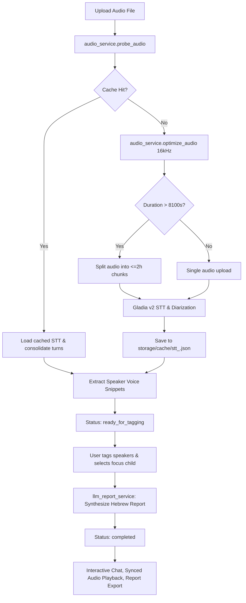

# AGENTS.md — Developer & AI Agent Guide

Quick-reference architectural guide for AI agents and developers working on `kindergarden-monitor`.

---

## 1. System Overview & Architecture

Full-stack application analyzing long (up to 5+ hours) kindergarten classroom audio recordings in Hebrew:
- **Audio Optimization & Chunking**: `ffmpeg` converts raw audio to 16kHz mono MP3; splits audio if duration exceeds provider limits (Gladia 8,100s / 2.25h limit).
- **Hebrew STT & Diarization**: Gladia (primary), Deepgram, or Mock. Segments are consolidated into fluent conversational turns (gap $\le$ 3.0s).
- **Fast Audio Hash Caching**: Fast 3-chunk SHA-256 hash skips STT completely on repeated audio files.
- **Speaker Tagging & Focus Child**: Users tag detected speakers, assign roles, and designate the target child.
- **Pedagogical Report Generation**: OpenRouter (`qwen/qwen3.8-flash` or `anthropic/claude-3.5-sonnet`) generates multi-section Hebrew pedagogical reports.
- **Interactive Agentic Chat**: LLM chatbot with tools to search transcripts, filter by timestamps, inspect reports, and control the audio player.
- **Frontend**: Single-page RTL Hebrew interface (Tailwind CSS, vanilla modular JS).

---

## 2. Directory & Key File Map

```
kindergarden-monitor/
├── run.py                          # Server launcher (uvicorn backend.app.main:app --reload)
├── .env                            # API keys & configurations
├── storage/                        # Persistent data directory
│   ├── uploads/                    # Raw uploaded audio files
│   ├── processed/                  # Optimized 16kHz MP3s & chunks
│   ├── snippets/                   # Isolated 5-10s speaker voice clips
│   ├── cache/                      # STT JSON caches (stt_<sha256>.json)
│   └── db.sqlite3                  # SQLite database
├── backend/app/
│   ├── config.py                   # Pydantic Settings & binary paths (ffmpeg/ffprobe)
│   ├── database.py                 # Async SQLAlchemy engine & session maker
│   ├── models.py                   # SessionModel, SpeakerModel, TranscriptSegmentModel, DailyReportModel
│   ├── schemas.py                  # Pydantic request/response schemas
│   ├── api/
│   │   ├── sessions.py             # Upload audio, session status, re-run report
│   │   ├── audio.py                # Audio stream & speaker snippet endpoints
│   │   ├── speakers.py             # Speaker role assignment & target child submission
│   │   ├── transcripts.py          # Paginated & searchable transcript API
│   │   ├── reports.py              # Markdown/HTML report view & download
│   │   ├── chat.py                 # Agentic chat API endpoint
│   │   └── settings.py             # Config & API key status
│   └── services/
│       ├── audio_service.py        # ffmpeg probe, optimize, extract snippet, split chunks
│       ├── cache_service.py        # Fast audio file hashing, STT cache read/write/consolidate
│       ├── job_pipeline.py         # Main asynchronous processing pipeline & background jobs
│       ├── stt/
│       │   ├── base.py             # BaseSTTProvider, STTResult, consolidate_utterances()
│       │   ├── gladia.py           # Gladia v2 API client (with auto-chunking >8100s)
│       │   ├── deepgram.py         # Deepgram Nova-2 client
│       │   └── mock.py             # Rich mock STT data for testing
│       └── llm/
│           ├── report_service.py   # Daily pedagogical report generator (OpenRouter / fallbacks)
│           ├── chat_agent.py       # Tool-calling chat agent (transcript search & timeline)
│           └── prompts.py          # Pedagogical analysis system prompts
├── frontend/
│   ├── index.html                  # Main UI layout (Dashboard, Audio Player, Transcript, Report, Chat)
│   ├── css/styles.css              # Custom styling
│   └── js/
│       ├── api.js                  # Frontend API client
│       ├── app.js                  # Main controller, polling & tab orchestration
│       ├── audio_player.js         # Audio playback, speed, time tracking, transcript sync
│       ├── tagging_modal.js        # Speaker voice snippet review & tagging modal
│       └── chat_controller.js      # Assistant chat UI & audio seek integration
├── scripts/
│   └── consolidate_sessions.py     # Batch consolidation migration script for DB transcript segments
└── tests/
    └── test_pipeline.py            # Async integration & pipeline tests
```

---

## 3. Core Execution Flow



---

## 4. How to Add / Modify Components

### A. Add a New STT Provider
1. Create `backend/app/services/stt/<provider>.py` subclassing `BaseSTTProvider` (`backend/app/services/stt/base.py`).
2. Implement `async def transcribe(self, audio_path: str, duration_seconds: float, progress_callback=None) -> STTResult`.
3. Wrap final utterances with `consolidate_utterances(utterances, max_gap_seconds=3.0)`.
4. Register the new provider in `backend/app/services/stt/__init__.py`.
5. Add provider config in `backend/app/config.py`.

### B. Change or Tune LLM Prompts & Models
- **Report System Prompt**: In `backend/app/services/llm/prompts.py` (`PEDAGOGICAL_REPORT_SYSTEM_PROMPT`).
- **Report Generation Logic**: `backend/app/services/llm/report_service.py`. Default model is `settings.OPENROUTER_MODEL` (e.g. `qwen/qwen3.8-flash`).
- **Chat Agent Tools & Behavior**: In `backend/app/services/llm/chat_agent.py`. The agent has built-in tools:
  - `search_transcript(query, speaker_name)`
  - `get_transcript_timeframe(start_seconds, end_seconds)`
  - `get_report_summary()`
  - `seek_audio_player(time_seconds)`

### C. Change Transcript Segment Consolidation
- Utterance consolidation merges consecutive micro-utterances from the same speaker if time gap $\le 3.0\text{s}$.
- Defined in `backend/app/services/stt/base.py`:
  - `consolidate_utterances(utterances, max_gap_seconds=3.0)`
  - `consolidate_utterance_dicts(raw_dicts, max_gap_seconds=3.0)`
- To re-consolidate database records after modifying logic:
  ```bash
  PYTHONPATH=. python3 scripts/consolidate_sessions.py
  ```

### D. Extend the Frontend
- **API calls**: Add methods to `frontend/js/api.js`.
- **UI State & Tabs**: Add logic to `frontend/js/app.js`.
- **Chat actions**: Seek-player triggers and chat events are in `frontend/js/chat_controller.js`.

---

## 5. Debugging & Common Pitfalls

| Issue | Cause | Fix / Solution |
|---|---|---|
| **Gladia 400: Audio duration > 8100s** | Gladia upload rejects files over 8,100 seconds (~2.25 hours). | Handled in `backend/app/services/stt/gladia.py` via `_transcribe_chunked()`: splits audio into $\le 7,000$s chunks, transcribes each with offset, and joins tags. |
| **Gladia file upload response format** | `/v2/upload` returns `{"audio_metadata": {"id": "..."}}` or `{"id": "..."}`. | In `gladia.py`, use `data.get("audio_metadata", {}).get("id") or data.get("id")` and pass as `{"audio": {"id": file_id}}`. |
| **STT turns are 1-word fragments** | Raw STT diarization splits single sentences across tiny 1-second segments. | Use `consolidate_utterances` / `consolidate_utterance_dicts` (`max_gap_seconds=3.0`). |
| **Large audio hashing is slow** | Full SHA-256 on 1GB+ files blocks I/O. | `CacheService.compute_file_hash()` samples three 4MB blocks (start, middle, end) + file size, completing in milliseconds. |
| **FFmpeg binary not found** | Host lacks system `ffmpeg` in path. | `backend/app/config.py` automatically checks `~/.local/bin/ffmpeg` and falls back to `static_ffmpeg`. |
| **`ModuleNotFoundError: No module named 'backend'`** | Running scripts from shell without package root. | Always run with `python3 -m pytest` or set `PYTHONPATH=. python3 scripts/...`. |

---

## 6. CLI & Testing Cheat Sheet

```bash
# Run Development Server
python3 run.py
# (Default URL: http://localhost:8000)

# Run Full Test Suite
python3 -m pytest

# Run Specific Test
python3 -m pytest tests/test_pipeline.py -k test_upload_and_pipeline

# Re-consolidate Database Transcripts & Cache
PYTHONPATH=. python3 scripts/consolidate_sessions.py
python3 -c "from backend.app.services.cache_service import cache_service; cache_service.consolidate_disk_cache()"

# Inspect Session & Speaker Counts
python3 -c "
import asyncio
from backend.app.database import AsyncSessionLocal
from backend.app.models import SessionModel, SpeakerModel
from sqlalchemy import select

async def check():
    async with AsyncSessionLocal() as db:
        res = await db.execute(select(SessionModel))
        for s in res.scalars():
            print(f'Session {s.id}: status={s.status}, duration={s.duration_seconds}s')

asyncio.run(check())
"
```
